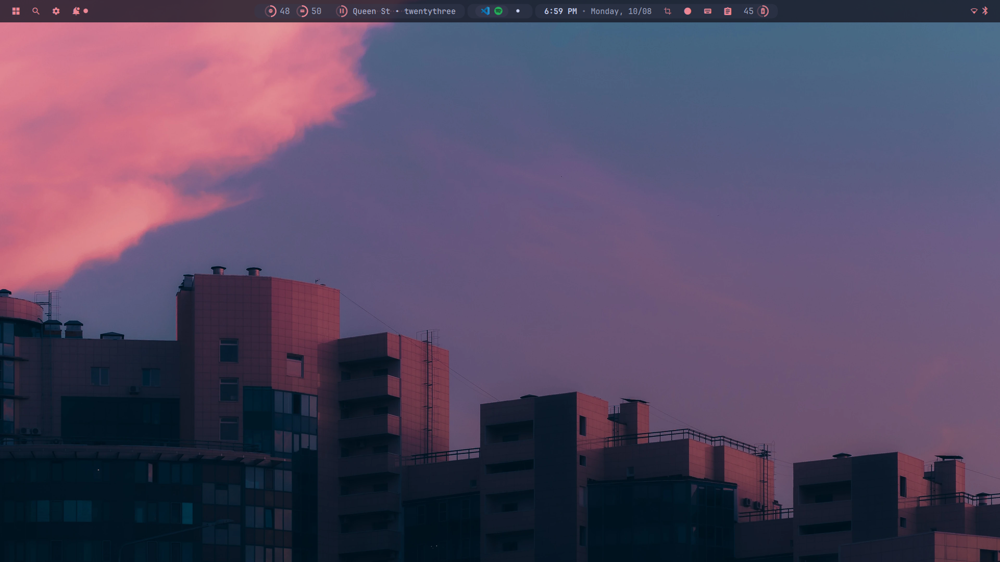
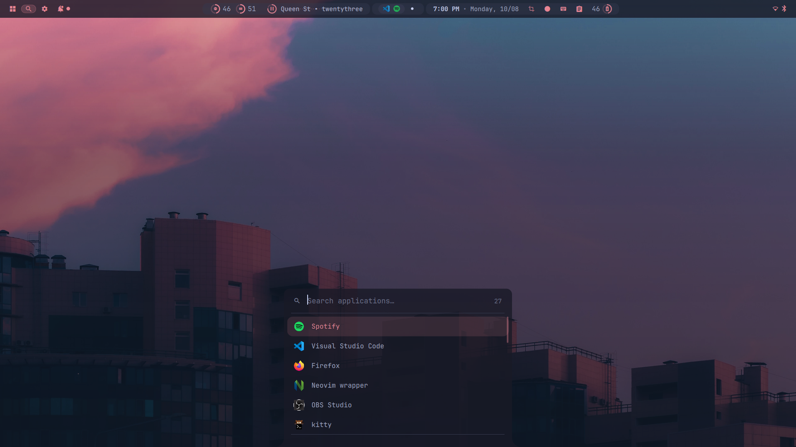
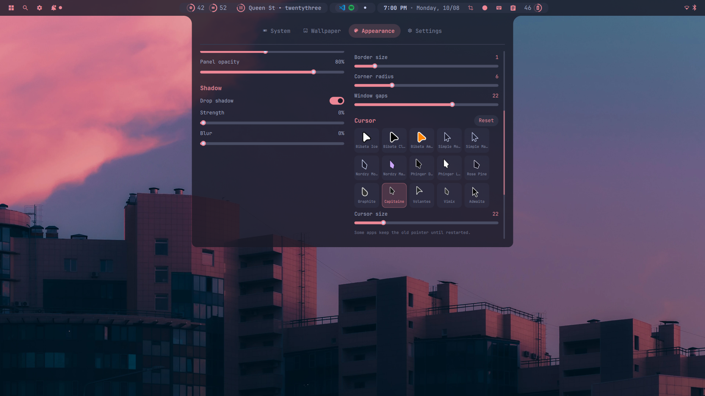
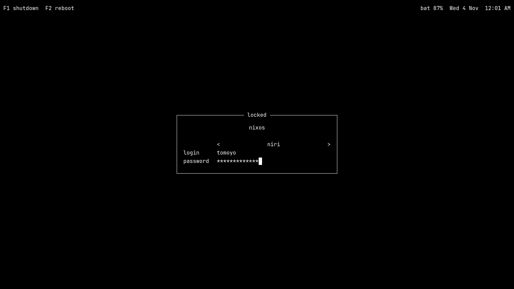
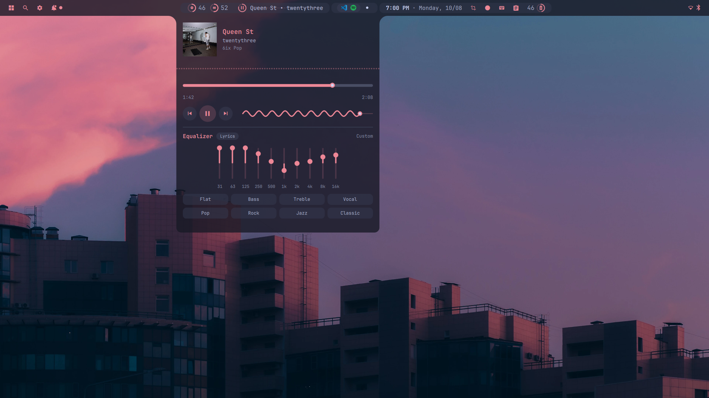

<div align="center">

# dotfiles

**NixOS · niri · a Quickshell desktop shell written from scratch**

Catppuccin across the whole system, driven from one settings panel.

</div>



---

## What this is

A scrolling-compositor desktop built around a custom shell — not a Waybar config
with extra CSS. The bar, launcher, dashboard, notification toasts, OSD, clipboard
manager and media player are ~15,000 lines of QML across 90 files, talking to niri
over IPC and to the system over MPRIS, D-Bus, PipeWire and cliphist.

The part worth stealing is the theming. Pick an accent in the Appearance tab and it
reaches the bar, the window borders, the terminal, the lock screen, GTK apps, the
cursor and Spotify — live, no restarts, no reload script.

| | |
|---|---|
| **OS** | NixOS 26.05 (Yarara) |
| **Compositor** | [niri](https://github.com/YaLTeR/niri) 26.04 — scrolling, not tiling |
| **Shell** | [Quickshell](https://quickshell.org) 0.3.0 (QML / Qt 6.11) — written from scratch |
| **Terminal** | kitty + fish + starship |
| **Editor** | Neovim 0.12, lazy.nvim, 12 plugins |
| **Wallpaper** | drawn by the shell: sharp behind windows, fading out in the overview so the see-through workspaces show a GPU-blurred copy in niri's backdrop |
| **Font** | JetBrainsMono Nerd Font |
| **Palette** | Catppuccin — 4 flavours × 16 accents |

---

## Screenshots

### Launcher — `Mod+D`

Fuzzy app search with recents. Reads `.desktop` entries with correct XDG
precedence, so a user override in `~/.local/share/applications` actually wins.



### Dashboard — `Mod+A`

Four tabs (System, Wallpaper, Appearance, Settings). Every control writes straight
through to a JSON file and re-lays out the bar as you drag. Below: the cursor
picker, which curates ~200 installed theme directories down to 15 and renders its
own previews with `xcur2png`.



### Lock — `Mod+Alt+L`, or close the lid

Drawn exactly like ly, the login screen at boot: white on black, the same
box, date and time top right, no animation. Built on ext-session-lock, so the
compositor draws nothing else until PAM accepts the password, and the session
behind it is exactly as you left it. Closing the lid suspends, locking first,
so waking shows this screen. <kbd>F1</kbd> / <kbd>F2</kbd> shut down / reboot
(press twice). If the bar is not running, `lock.sh` starts it first.



### Media — `Mod+P`

MPRIS player with album art, a seekable scrubber, a live cava visualiser, a
10-band PipeWire equalizer with presets, and a lyrics pane that swaps with the
equalizer.



---

## The shell

Lives in [`config/quickshell`](config/quickshell) — 90 QML files, 26 services.

**Bar.** Left cluster (launcher, search, settings, notifications) · CPU and memory ·
media pill with a scrolling marquee · workspace capsules with app icons · clock ·
screenshot · screen recorder · keyboard layout · clipboard · battery · network.

**Dropdown panels.** Calendar, network (with a WiFi password prompt), Bluetooth,
battery detail, clipboard history with image thumbnails, notification centre.

**Services.** 26 singletons — among them `Cava` (audio bands), `Cliphist`,
`Eq` (PipeWire filter-chain), `Lyrics` (LRCLIB), `NightLight`, `Recorder`,
`SysMon`, `Wallpapers`, `Todos`, `Keybinds` (edits niri's binds from the GUI),
and one theming service per target.

**IPC.** The bar exposes a handler niri binds to directly:

```sh
qs ipc call bar toggle launcher|media|network|clipboard|calendar
qs ipc call bar tab    system|wallpaper|appearance|settings
```

---

## Theming

One accent change fans out to every one of these:

| Target | How |
|---|---|
| Bar and panels | `Theme.qml`, reactive — no reload |
| niri borders, focus ring, gaps, corner radius | rewrites `config.kdl` in place; niri hot-reloads |
| kitty | generated `colors.conf` |
| Lock screen | always white on black, like ly — not themed on purpose |
| GTK 3/4 | `settings.ini` + `gsettings`, live over dconf |
| Cursor | `~/.icons/default`, `gsettings`, and niri's `cursor` block |
| Spotify | spicetify `text` theme, pushed into the running client over CDP |

Two rules the code sticks to. **`config.kdl` has exactly one writer** — a second
service racing it is how hand-edited lines get clobbered, so the cursor picker asks
`NiriTheme` to do the write rather than doing it itself. And **generated files are
never tracked** — every one carries a `do not edit` header and is listed in
`.gitignore`, so moving a slider doesn't dirty the tree.

Spotify's live path is worth a note: `spotify-theme --live` pushes 25 CSS
variables over the Chrome DevTools Protocol via a hand-rolled stdlib WebSocket
client, so the theme follows the slider in well under a second without restarting
the client.

---

## Keybinds

`Mod` is <kbd>Super</kbd>. Full list in [`config/niri/config.kdl`](config/niri/config.kdl);
`Mod+Shift+/` shows niri's own overlay.

### Shell

| Key | Action |
|---|---|
| <kbd>Mod</kbd>+<kbd>D</kbd> | Launcher |
| <kbd>Mod</kbd>+<kbd>A</kbd> | Dashboard — Appearance |
| <kbd>Mod</kbd>+<kbd>Shift</kbd>+<kbd>1..4</kbd> | Dashboard — System / Wallpaper / Appearance / Settings |
| <kbd>Mod</kbd>+<kbd>P</kbd> | Media player |
| <kbd>Mod</kbd>+<kbd>N</kbd> | Network |
| <kbd>Mod</kbd>+<kbd>Y</kbd> | Clipboard history |
| <kbd>Mod</kbd>+<kbd>T</kbd> | Calendar |
| <kbd>Mod</kbd>+<kbd>Tab</kbd> | Overview |

### Apps

| Key | Action |
|---|---|
| <kbd>Mod</kbd>+<kbd>Return</kbd> | kitty |
| <kbd>Mod</kbd>+<kbd>E</kbd> | yazi |
| <kbd>Mod</kbd>+<kbd>G</kbd> | GIMP |
| <kbd>Mod</kbd>+<kbd>Z</kbd> | Colour picker |
| <kbd>Ctrl</kbd>+<kbd>Shift</kbd>+<kbd>S</kbd> | Mullvad |

### Windows and columns

| Key | Action |
|---|---|
| <kbd>Mod</kbd>+<kbd>Q</kbd> | Close |
| <kbd>Mod</kbd>+<kbd>H</kbd> <kbd>J</kbd> <kbd>K</kbd> <kbd>L</kbd> | Focus (arrows work too) |
| <kbd>Mod</kbd>+<kbd>Shift</kbd>+<kbd>HJKL</kbd> | Move |
| <kbd>Mod</kbd>+<kbd>[</kbd> / <kbd>]</kbd> | Consume or expel window |
| <kbd>Mod</kbd>+<kbd>,</kbd> / <kbd>.</kbd> | Consume into / expel from column |
| <kbd>Mod</kbd>+<kbd>R</kbd> | Cycle preset column width |
| <kbd>Mod</kbd>+<kbd>-</kbd> / <kbd>=</kbd> | Width ∓10% |
| <kbd>Mod</kbd>+<kbd>F</kbd> | Maximise column |
| <kbd>Mod</kbd>+<kbd>Shift</kbd>+<kbd>F</kbd> | Fullscreen |
| <kbd>Mod</kbd>+<kbd>C</kbd> | Centre column |
| <kbd>Mod</kbd>+<kbd>V</kbd> | Float |
| <kbd>Mod</kbd>+<kbd>W</kbd> | Tabbed column |

### Workspaces and monitors

| Key | Action |
|---|---|
| <kbd>Mod</kbd>+<kbd>1..9</kbd> | Focus workspace |
| <kbd>Mod</kbd>+<kbd>Ctrl</kbd>+<kbd>1..9</kbd> | Move column to workspace |
| <kbd>Mod</kbd>+<kbd>U</kbd> / <kbd>I</kbd> | Workspace down / up |
| <kbd>Mod</kbd>+<kbd>Scroll</kbd> | Switch workspace |
| <kbd>Mod</kbd>+<kbd>Ctrl</kbd>+<kbd>HJKL</kbd> | Focus monitor |
| <kbd>Mod</kbd>+<kbd>Shift</kbd>+<kbd>Ctrl</kbd>+<kbd>HJKL</kbd> | Move column to monitor |

### Session

| Key | Action |
|---|---|
| <kbd>Mod</kbd>+<kbd>Shift</kbd>+<kbd>S</kbd> | Screenshot region |
| <kbd>Print</kbd> | Screenshot screen |
| <kbd>Mod</kbd>+<kbd>Shift</kbd>+<kbd>P</kbd> | Power off monitors |
| <kbd>Mod</kbd>+<kbd>Alt</kbd>+<kbd>L</kbd> | Lock |
| <kbd>Mod</kbd>+<kbd>Escape</kbd> | Inhibit shortcuts |
| <kbd>Mod</kbd>+<kbd>Shift</kbd>+<kbd>E</kbd> | Quit niri |

Media, volume, brightness and mic-mute keys all work, and stay live while locked.

---

## Layout

The tree mirrors where things actually live, so the mapping is obvious:

```
flake.nix       the system: one pinned nixpkgs, one entry per nixos/hosts/<name>
nixos/
  common.nix      the desktop — identical on every machine
  hosts/nixos/    this laptop only: hostname, Intel VA-API, swap, stateVersion
  pkgs/           zen-browser, wl-uinput-proxy — pinned, not in nixpkgs
  configuration.nix  legacy shim, so a plain `nixos-rebuild` still works
config/         everything under ~/.config                           -> symlinked
  quickshell/     the shell — surfaces, widgets, components, services, scripts
  niri/           config.kdl, wallpaper startup
  nvim/           init.lua, lua/{options,keymaps,plugins,lsp}.lua, lazy-lock.json
  kitty/ fish/ fastfetch/ starship.toml       one file each, linked file by file
local/
  bin/            rice, spotify-sync, spotify-theme, spotify-cdp,    -> ~/.local/bin
                  volume
  share/applications/  spotify.desktop, launching the patched copy
state/quickshell/  the shell's look: settings, theme presets, EQ  -> seeded once
tools/ricemap.py   renders the whole repo as one browsable page (`rice map`)
assets/         screenshots
```

## Deploy

Everything goes through one script, [`local/bin/rice`](local/bin/rice):

```sh
# a fresh NixOS install
nix-shell -p git --run 'git clone https://github.com/tomoyo-cpp/quickshell ~/dotfiles'
~/dotfiles/local/bin/rice install       # everything, once

# day to day
rice              # is everything ok? links, system, VPN, DNS, lock
rice apply        # after any change: link dotfiles + rebuild NixOS
rice save         # copy the shell's current look into state/
rice update       # newer packages (the only thing that moves nixpkgs)
```

`rice help` lists the rest (`diff`, `link`, `boot`, `new-host`, `map`).

Dotfiles are symlinks, so an edit is live the moment it is saved — only
`nixos/` needs `rice apply`. When the login screen itself changes, `apply`
rebuilds for the next boot instead, so the running session is not ended. Linking (`rice link`, also `./install.sh`) is idempotent: a correct symlink is left alone, anything real in
the way is moved to `<path>.backup-<timestamp>`, and shell state is only ever
seeded, never overwritten.

Only files git tracks are linked, one by one — so kitty's generated colours,
fish's universal variables or a game's desktop entry land on the machine,
never in the repo. The exceptions are `quickshell/`, `niri/` and `nvim/`,
which belong to the rice outright and are linked whole. Untracking a file and
running `rice apply` moves it back out into place: that is how application
settings (VS Code, OBS, Thunar, btop) left the repo without being lost.

**Another machine:** `rice new-host <name>` scaffolds `nixos/hosts/<name>/`
(hostname, GPU, swap, its own stateVersion); the flake picks up every
directory there by itself, keyed by hostname.

**Why `--impure`:** a host's `hardware-configuration.nix` is read from that
machine's `/etc/nixos` rather than committed (it is filesystem UUIDs). `rice`
passes the flag; by hand it is `nixos-rebuild switch --flake ~/dotfiles --impure`.
Committing one at `nixos/hosts/<name>/hardware-configuration.nix` makes that
host pure instead.

---

## Privacy

Built in, on every machine the flake deploys to:

| | |
|---|---|
| VPN | Mullvad daemon, driven from the bar — a shield next to Wi-Fi and Bluetooth, and a VPN tab in the network panel beside them (connect, location, lockdown, auto-connect, DNS blocklists) |
| DNS | systemd-resolved → Mullvad's blocklisting resolver over DNS-over-TLS, Quad9 as fallback; DHCP-supplied resolvers are ignored |
| Tor | Tor Browser, plus a system tor client for `torsocks <command>` |
| Network identity | a different MAC per network, no hostname sent over DHCP, temporary IPv6 addresses |
| Firewall | on, nothing open |
| Screen | locks before every suspend (lid close suspends), after 10 minutes idle, and on <kbd>Mod</kbd>+<kbd>Alt</kbd>+<kbd>L</kbd> |
| Passwords | KeePassXC: one encrypted `.kdbx` file in `~/Vault`, no account or server. In browsers its extension (installed once by policy) fills logins; for other apps, copy from KeePassXC (Auto-Type does not work on Wayland). Its window is blacked out of screenshots and screen shares, and copies from it stay out of clipboard history |
| Sync | Syncthing keeps `~/Vault` the same on your other devices, device to device over TLS with no cloud copy; pair them at http://127.0.0.1:8384 (this machine only). Changed and deleted files are kept as versions in `~/Vault/.stversions` |
| Online lookups | lyrics and web album art, one switch in Settings → Behaviour |
| Login | ly on tty1 — no autologin |
| Telemetry | `DO_NOT_TRACK`, .NET opt-out |

`rice status` checks the parts that are runtime settings rather than config:
whether Mullvad is connected, and whether auto-connect and lockdown mode
(nothing leaves outside the tunnel) are on.

Remote desktop is not part of the rice — no Tailscale, no open ports. It is
a separate flake (`~/remote-desktop`) that layers itself onto the running
system with `nixos-rebuild test` only while it is needed.

---

## Notes if you're borrowing this

- **`hardware-configuration.nix` is deliberately not here.** It is nothing but
  filesystem UUIDs specific to one laptop — useless to you and a stable
  hardware fingerprint if published. Run `nixos-generate-config` and yours
  appears at `/etc/nixos/hardware-configuration.nix`, which is where the flake
  reads it from.
- **Spotify needs `spotify-sync` first** (`rice post` runs it). spicetify can't patch the read-only
  nixpkgs build, so the script builds a writable copy (~103 MB, symlinking
  everything but `Apps/`) and repoints the wrapper at it.
- **Mason won't work.** It fetches dynamically linked binaries; language servers
  come from `configuration.nix` instead, wired up with `vim.lsp.enable`.
- **Generated files are absent by design** — kitty colours, GTK `settings.ini`,
  They appear the first time the shell runs. `gtk-3.0/` and `gtk-4.0/`
  aren't symlinked at all: their writers use atomic
  writes, which replace a symlink with a regular file.
- **`~/.gitconfig` is not here.** It only holds a name and email, and those are
  yours to set.
- **Application settings are not here** — VS Code, OBS, browsers, games.
  Only the rice is.
- **The volume keys go through [`local/bin/volume`](local/bin/volume), not
  `wpctl` directly.** The equalizer in `configuration.nix` is a filter-chain
  sink, and making it the default puts two volume stages in series — what you
  hear is the filter's level times the real device's. Moving only the first
  leaves the second as a ceiling you cannot see: a Bluetooth headset that
  reconnected at 62% capped output there however far the keys were pushed. The
  script pins every non-default sink to unity so one stage decides the level.
  Copy the equalizer without it and you inherit the bug.
- **Wallpapers are not in the repo.** The Wallpaper tab reads
  `~/Pictures/Wallpapers`; the pick is kept in `~/.local/state/rice/wallpaper`,
  and with nothing picked the first image there is used.
